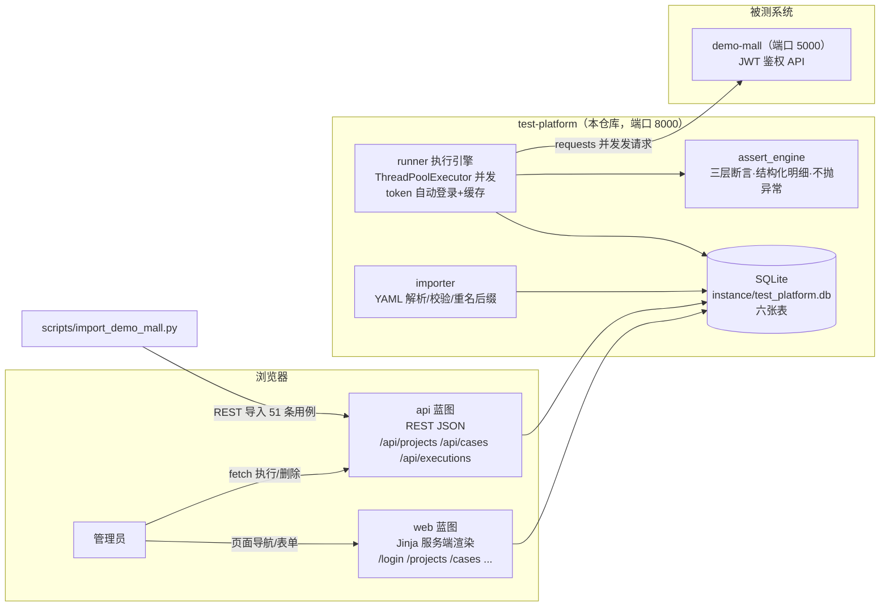

# test-platform · 轻量级接口测试平台

> 把 [api-test-framework](../api-test-framework) 的"三层断言 + 数据驱动"测试思想，从本地 pytest 脚本变成**在线服务**：
> 用例入库管理 → 一键/并发执行 → 结构化断言明细 → 报告统计。与被测系统 [demo-mall](../demo-mall) 同栈（Flask + SQLite + Jinja），clone 后 3 条命令跑起来。

## 架构总览



## 三步启动

```bash
# 0) 安装依赖（Python 3.13 实测版本锁定）
pip install -r requirements.txt

# 1) 初始化管理员/演示项目/示例用例（--reset 可随时重置）
python -m app.seed --reset

# 2) 启动平台（默认 8000 端口）
python run.py
```

打开 http://127.0.0.1:8000 ，登录 `admin / admin123`。

## 导入 demo-mall 的现成用例（可选，推荐）

先另起被测系统：`cd ../demo-mall && python run.py --port 5000`，然后：

```bash
python scripts/import_demo_mall.py --url http://127.0.0.1:8000 --api-base http://127.0.0.1:5000
# [3/3] 导入完成：成功 51 条，跳过 0 条，项目 id=1
# （另有 3 条种子示例用例，项目共 54 条；chain_data.yaml 的 4 条链路用例跳过，属 v2 多步编排）
```

## 功能清单

| 模块 | 能力 |
|---|---|
| 认证 | pbkdf2 密码摘要、session 登录态、页面/API 双装饰器（302 与 401+4010 两种口径） |
| 项目管理 | 项目 = 一组用例 + 默认被测环境 base_url；CRUD + 最近批次徽标 |
| 用例管理 | 方法/路径/请求头/查询串/请求体/自动登录账号/三层期望；表单与 REST 双入口；重名自动加后缀 |
| YAML 导入 | 平台自有格式批量导入；`scripts/import_demo_mall.py` 演示"参考框架 YAML → 平台格式"映射 |
| 执行引擎 | 单条/整批执行；ThreadPoolExecutor 并发（默认 5）；token 自动登录并进程内缓存；网络错误降级为失败明细 |
| 三层断言 | HTTP 状态码 / 业务 code / JSONPath 字段——全部执行、结构化明细、**不抛异常**（与 pytest 版的关键差异） |
| 报告统计 | 批次通过率、每条用例 `<details>` 折叠的请求/响应快照（token 脱敏）+ 断言明细表；统计页 |
| 平台自测 | 38 条 pytest（35 单测 + 3 集成），`-m "not integration"` 可跳过依赖 demo-mall 的部分 |

页面截图占位（启动后自行截取）：

- 登录页：`docs/screenshots/login.png`（占位）
- 用例列表 + 最近结果徽标：`docs/screenshots/cases.png`（占位）
- 执行详情折叠明细：`docs/screenshots/execution_detail.png`（占位）

## 目录结构

```
test-platform/
├── run.py                  # 启动入口（argparse --port，默认 8000）
├── config.py               # SECRET_KEY/端口/DB 路径/并发数/超时
├── app/
│   ├── __init__.py         # create_app 工厂（注册蓝图、teardown 关库、模板过滤器）
│   ├── db.py               # sqlite3 g 连接 + query_one/query_all/execute/insert
│   ├── schema.sql          # 六张表（users/projects/cases/executions/execution_items/import_logs）
│   ├── auth.py             # pbkdf2 摘要 + login_required / api_login_required
│   ├── seed.py             # python -m app.seed --reset 初始化管理员/演示项目/示例用例
│   ├── importer.py         # 平台 YAML 格式解析/校验/重名后缀/导入留痕
│   ├── assert_engine.py    # 三层断言：check(resp, expect) -> 明细列表，不抛异常
│   ├── runner.py           # execute_case / execute_batch（并发 + 落库 + token 缓存）
│   ├── api/                # 平台 REST JSON（前端 fetch 与导入脚本共用）
│   ├── web/                # 页面路由（服务端渲染）
│   ├── templates/          # base/login/projects/cases/case_form/executions/execution_detail/stats
│   └── static/style.css
├── scripts/
│   └── import_demo_mall.py # api-test-framework YAML → 平台格式导入演示
├── tests/                  # 38 条 pytest（单测 + Web/API + 集成）
└── docs/                   # ★逐模块教学文档（00~07 共八篇）
```

## 与参考实现的关系

| | api-test-framework（pytest 版） | test-platform（平台版） |
|---|---|---|
| 使用方式 | 本地跑 pytest，看控制台/Allure | 浏览器点点点，团队共用 |
| 用例存放 | data/*.yaml + 代码同仓库 | 数据库，网页/REST 维护 |
| 断言 | assert_response 抛 AssertionError（fail fast） | check() 返回结构化明细（报告友好） |
| 执行 | pytest 进程顺序执行 | 平台内线程池并发执行 |
| 鉴权关联 | conftest 注入 token + 401 自动重登 | 用例配 auth 块，执行前自动登录并缓存 token |
| 交集 | 三层断言思想、响应约定知识完全同源 | |

## 常见坑（先读少踩）

1. **Windows 系统代理**：系统代理开着时（如 127.0.0.1:7897），requests 默认会把发往
   `127.0.0.1:5000` 的请求也丢给代理。平台所有出站 Session 都设了
   `session.trust_env = False`；自己写脚本调平台/被测系统时建议同样处理。
2. **expect_code=0 是合法期望**：判空必须用 `is not None`，写成 `if expect_code:`
   会把 0 当成"没配"，三层断言悄悄少一层（tests 里有回归用例）。
3. **重复执行前先重置被测数据**：导入用例里有"注册新用户成功"这类有状态正向用例，
   demo-mall 不重置直接跑第二批会按预期失败（这正是它测的东西）：
   `curl -X POST http://127.0.0.1:5000/api/test/reset -H "X-Test-Key: mall-test-key"`。
4. **SQLite 连接不能跨线程**：执行引擎因此设计为"HTTP 并发在 worker 线程、
   落库回调用线程串行"，不要把 `get_db()` 拿进线程池里用。
