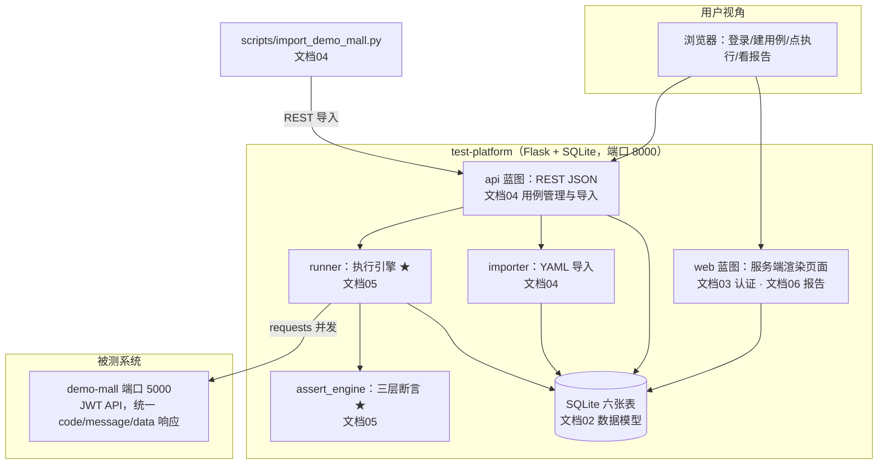

# test-platform · 文档00 项目总览

> 一句话：把"写 pytest 脚本测接口"升级为"搭一个在线接口测试平台"，本篇是全套教学文档的地图——为什么测开要会写平台、平台长什么样、怎么按文档顺序复现。

## 1. 在整个平台中的位置

本文档不对应单个模块，对应**全景**：



八篇文档的依赖关系（建议按序读）：

```
00 总览 → 01 技术选型 → 02 数据模型 → 03 认证 → 04 用例管理/导入
                                              ↘ 05 执行引擎(★) → 06 报告统计 → 07 平台自身的测试
```

## 2. 涉及文件

| 文件 | 作用 | 详细文档 |
|---|---|---|
| `run.py` / `config.py` / `app/__init__.py` | 启动入口 / 全局配置 / 应用工厂 | 01 |
| `app/schema.sql` / `app/db.py` | 六张表 / SQLite 连接助手 | 02 |
| `app/auth.py` | pbkdf2 + session + 双装饰器 | 03 |
| `app/importer.py` / `scripts/import_demo_mall.py` | 用例入库与批量导入 | 04 |
| `app/runner.py` / `app/assert_engine.py` | 执行引擎 / 断言引擎（核心） | 05 |
| `app/templates/*.html` / `app/static/style.css` | 页面与样式 | 06 |
| `tests/` | 平台自身的 38 条 pytest | 07 |

## 3. 如何实现（平台全景三分钟版）

### 3.1 平台解决什么问题

api-test-framework（pytest 版）已经能"数据驱动 + 三层断言"地测接口，但它有三个团队协作的硬伤：

1. **用例和代码耦合在一个仓库**——测试同事改一条断言要会 git；
2. **结果只在跑的人眼前**——没有历史、没有趋势、没法给别人看"昨天通过率多少"；
3. **执行靠命令行**——"上线前把 500 条用例全量跑一遍"需要一个按钮，而不是一个命令行约定。

test-platform 把这三件事变成服务：用例入库（网页/REST/YAML 导入三个入口）、结果落库（每批执行都有记录）、一键执行（浏览器点按钮，平台内部并发跑）。

### 3.2 一个用例的一生（串联所有模块）

```
YAML 文件 → import_demo_mall.py 转换 → POST /api/import → importer 校验/去重 → cases 表
→ 用户在页面点"一键执行" → POST /api/projects/1/execute
→ api 层建 executions 行(running) → runner.execute_batch
→ 线程池并发 execute_case：auth 自动登录换 token → requests 发请求
→ assert_engine.check 出三层断言明细 → execution_items 落库
→ executions 更新 total/passed/failed/duration → 报告页按 <details> 渲染快照与断言
```

### 3.3 与被测系统的约定（一切设计的源头）

demo-mall 的响应约定：成功 `HTTP 200 + {"code":0,...}`；业务失败 `HTTP 200 + code≠0`；鉴权失败 `HTTP 401 + code 4010`。
**正因为"HTTP 状态码"和"业务 code"会各错各的，三层断言才缺一不可**；平台自己的 API 也刻意采用同款约定（见文档03/07）。

### 3.4 AI 时代这套东西的含金量

- AI 能生成测试脚本，但**"判断生成的用例对不对、结果可不可信"需要平台和工程化**：确定性数据、结构化断言、可重复执行，这些是 AI 产出质量的"标尺"；
- 面试官区分"会写脚本"和"会做工程"的分水岭，就是能否讲清**执行引擎的并发模型、断言为什么不抛异常、数据模型为什么这么拆**——这三问的答案分别在文档05、05、02；
- 平台代码总量约 2000 行，每一行都有"为什么"，没有一行是企业级黑盒——这正是"看懂 → 能复现 → 能讲清"的最佳体量。

## 4. 为什么这样设计（全景级决策）

| 决策 | 选择 | 备选 | 理由摘要 |
|---|---|---|---|
| 技术栈 | Flask + SQLite + Jinja（与 demo-mall 同栈） | FastAPI + PostgreSQL | 复现成本最低、两项目概念一一对应；对比详见文档01 |
| 用例存储 | 数据库（可在线编辑） | 继续 YAML 文件 | 平台化的意义就在于"用例是数据" |
| 执行 | 平台进程内线程池 | 调 pytest/Jenkins | 毫秒级反馈、无外部依赖；演进路线见文档01/05 |
| 断言 | 返回结构化明细不抛异常 | 沿用 assert 失败即停 | 报告要展示"每条断言过没过"，见文档05 |
| 平台自测 | pytest + Flask test client | 手工点 | 平台自己就是被测系统，见文档07 |

## 5. 怎么运行验证（真实输出）

```bash
cd D:\软件测试\test-platform
pip install -r requirements.txt
python -m app.seed --reset
python run.py --port 8000
```

真实输出：

```
[test-platform] 管理员 admin/admin123 (id=1)
[test-platform] 演示项目 'Demo商城接口' (id=1)，示例用例 3 条
[test-platform] 已重置：六张表清空 + 种子数据重灌
[test-platform] 数据库：D:\软件测试\test-platform\instance\test_platform.db
[test-platform] http://127.0.0.1:8000 （Flask 内置服务器，登录账号 admin/admin123）
```

再导入全量用例并执行（被测系统先跑起来并重置数据）：

```bash
curl -X POST http://127.0.0.1:5000/api/test/reset -H "X-Test-Key: mall-test-key"
python scripts/import_demo_mall.py --url http://127.0.0.1:8000 --api-base http://127.0.0.1:5000
```

```
  cart_data.yaml: 转换 13 条，跳过 0 条
  chain_data.yaml: 转换 0 条，跳过 4 条
  goods_data.yaml: 转换 14 条，跳过 0 条
  login_data.yaml: 转换 12 条，跳过 0 条
  order_data.yaml: 转换 12 条，跳过 0 条
[3/3] 导入完成：成功 51 条，跳过 0 条，项目 id=1
```

页面点"一键执行"后，批次结果 **54/54 全部通过（总耗时约 250~300ms）**。

## 6. 常见坑

1. **端口没起对**：平台 8000、被测系统 5000，配反了执行全部报"网络请求失败"——先 `curl /api/health` 双向确认。
2. **重复执行"全量用例"前忘了重置被测数据**：`[认证] 注册新用户成功` 第二批会失败（重名 1003），这是用例的**正确行为**而非平台 bug；重跑前先调 `/api/test/reset`。
3. **在平台库里直接改数据**：绕过 API 手改 SQLite 后，页面与 API 的统计口径会"对不上"；排查顺序：`import_logs` 表看导入历史 → `executions` 表看批次数字 → 再看页面。
4. **把平台和被测系统跑在同一端口**：Flask 内置服务器默认不会报清晰错误，先 `netstat -ano | findstr 8000` 查占用。

## 7. 面试怎么讲（30 秒 + 3 追问）

**30 秒版本**：
"我为测试框架做了一次平台化：把 pytest 版接口框架的三层断言和数据驱动思想，做成 Flask + SQLite 的在线服务。用例入库管理、支持 YAML 批量导入，执行引擎用线程池并发发请求、自动登录换 token，断言从'抛异常'改成'返回结构化明细'，报告页每条用例可折叠看请求/响应快照和每条断言的过/挂。平台自身还有 38 条 pytest 保证质量。"

**追问 1：平台和 pytest 框架怎么分工？**
"pytest 版面向工程师本地调试与 CI 门禁，平台版面向团队协作与结果沉淀。断言引擎、响应约定两边同源，但断言的'输出形态'不同——脚本里要 fail fast 抛异常，报告里要全部执行返回明细。"

**追问 2：执行为什么不做成异步任务队列？**
"v1 的量级（百条用例、秒级完成）同步执行用户体验足够，先不引入 Celery/Redis 的复杂度；executions 表的 status=running 设计和'建记录/跑批分离'的函数签名已经为异步化留了口子，演进路径见文档05。"

**追问 3：怎么保证平台自己的质量？**
"平台自己也是被测系统：38 条 pytest 分三层——断言引擎纯单测（mock Response）、执行引擎单测（monkeypatch HTTP 出口）、Web/API 用 Flask test client 端到端；需要真被测系统的标 @pytest.mark.integration，可单独跳过。"

## 8. 复现任务清单

- [ ] 通读 demo-mall 与 api-test-framework 的 README，理解响应约定与三层断言
- [ ] `python -m app.seed --reset && python run.py`，登录平台
- [ ] 启动 demo-mall 并重置数据，运行 `scripts/import_demo_mall.py` 导入 51 条
- [ ] 页面点"一键执行"，确认 54/54 全绿，点开任意失败/通过用例看断言明细
- [ ] `python -m pytest tests/ -v -m "not integration"` 与 `python -m pytest tests/ -v` 全绿
- [ ] 按 01~07 文档顺序逐模块精读，每篇完成其"复现任务清单"
- [ ] 进阶：给平台加一个"用例批量启停用"字段，体会 schema 演进与迁移
