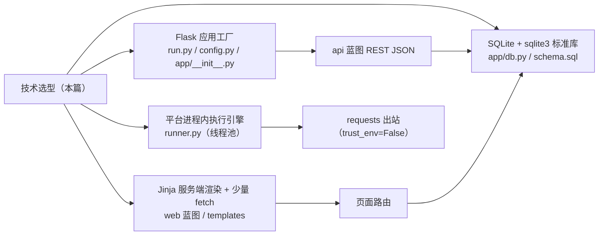

# test-platform · 文档01 技术选型与整体架构

> 一句话：为什么是 Flask + SQLite + Jinja 服务端渲染，而不是 FastAPI/Django/SPA；执行为什么放平台进程内，而不是调 pytest/Jenkins——每个选型都有明确的"下限成本"和"演进出口"。

## 1. 在整个平台中的位置

选型是所有模块的**地基**，约束了后面七篇的一切实现方式：



## 2. 涉及文件

| 文件 | 行数级 | 职责 |
|---|---|---|
| `run.py` | ~30 | argparse 入口，`--port` 默认 8000，`threaded=True` |
| `config.py` | ~50 | 全局常量：SECRET_KEY / DB_PATH / 并发数 / 超时 |
| `app/__init__.py` | ~60 | create_app 工厂：配置注入、建表、蓝图注册、context_processor |
| `requirements.txt` | 5 行 | 锁定本机实测版本（Flask 3.1.3 等） |

## 3. 如何实现

### 3.1 Web 框架对比（为什么 Flask）

| 维度 | Flask（选它） | FastAPI | Django |
|---|---|---|---|
| 心智模型 | 同步 WSGI、装饰器路由 | 异步 ASGI、类型注解驱动 | 全家桶（ORM/Admin/Auth） |
| 服务端渲染 | Jinja 原生 | 需另配 Jinja/模板引擎 | 自带模板但生态绑定 ORM |
| 学习/复现成本 | **最低**（与 demo-mall 同款） | 中（Pydantic/async 概念多） | 高（约定多，"魔法"多） |
| 自带 Admin/ORM | 无（也不需要） | 无 | 有（本平台用不上） |
| 与参考项目一致性 | demo-mall 就是 Flask | 无 | 无 |
| 面试叙事 | "被测系统与平台同栈，概念一一映射" | 适合 API-only 服务 | 适合重内容站点 |

关键理由是**同栈复现**：用户刚照文档看完 demo-mall 的 create_app 工厂、g 对象连接、蓝图拆分，马上在平台里看到完全相同的骨架——学习曲线是"平移"而不是"爬山"。对比 Django 还有个实际原因：本平台数据层刻意手写 SQL（教学透明），Django 的价值恰恰在 ORM/Admin，等于背着它的重量用不到它的好处。

### 3.2 应用工厂（create_app）

```python
def create_app(test_config: dict | None = None) -> Flask:
    app = Flask(__name__)
    app.config.from_object(config)          # 默认配置来自 config.py
    if test_config:
        app.config.update(test_config)      # 测试按需覆盖（DB_PATH/SECRET_KEY...）

    app.secret_key = app.config.get("SECRET_KEY", config.SECRET_KEY)

    if not os.path.exists(app.config["DB_PATH"]):
        from app.db import init_db
        init_db(app.config["DB_PATH"])      # 首次启动自动建表（幂等脚本）

    from app import db
    app.teardown_appcontext(db.close_db)    # 请求结束自动关库连接
```

`test_config` 参数是**平台可被测试的前提**：tests 里 `create_app({"DB_PATH": 临时路径})` 就得到一个完全隔离的实例。这就是"工厂模式 vs 模块级 app"的差别——模块级 app 的 DB 路径在 import 时就焊死了。

### 3.3 启动入口

```python
parser.add_argument("--port", type=int, default=config.PORT, ...)
app.run(host=config.HOST, port=args.port, debug=False, threaded=True)
```

`threaded=True` 必须开：浏览器页面与 fetch 请求并发到达，Flask 内置服务器默认单线程会把请求串行排队——执行一批用例时页面像卡死。`debug=False` 因为平台是"自己人用的服务"，不热重载，避免 reloader 双进程带来的线程池混乱。

### 3.4 服务端渲染 + 少量 fetch 的页面架构

| 动作 | 实现方式 | 为什么 |
|---|---|---|
| 看列表/详情 | 服务端渲染（路由查库 → 模板吐 HTML） | 首屏一次请求带全数据，无前端框架 |
| 执行/删除/新建项目 | 原生 `fetch()` 调 REST API，原地更新徽标或整页刷新 | 交互需要局部更新；JS 总量 < 100 行 |
| 表单提交 | 传统 POST + flash + redirect | 服务端校验复用 `importer.normalize_case`，一份逻辑 |

服务端渲染 vs SPA 的决策表：

| 维度 | 服务端渲染（选它） | SPA（React/Vue） |
|---|---|---|
| 依赖复杂度 | 0 构建工具 | node/npm/打包链 |
| 首屏与 SEO | 直出 | 需额外处理 |
| 交互密度需求 | 点按钮看报告，足够 | 高频局部刷新才必要 |
| 被自动化测试 | id 稳定、HTML 直出，requests 就能断言 | 需要 Playwright 级工具 |
| 面试叙事 | "为场景选复杂度，不为简历堆技术" | — |

SPA 只有一个真正优势——高频局部交互；平台的交互是"低频 + 整页级"，选 SPA 纯属给简历镶金，维护成本翻倍。作为补偿，平台所有可交互元素都带稳定 id（`btn-exec-case-<id>`、`badge-case-<id>`），以后要接 UI 自动化随时可以。

### 3.5 执行引擎放哪：两条路线对比

| 维度 | A. 平台进程内执行（v1 选它） | B. 平台调度 pytest/Jenkins 子进程 |
|---|---|---|
| 反馈速度 | 毫秒级触发，秒级完成 | 拉起解释器/流水线，十秒级起步 |
| 结果结构化 | 直接返回 dict，落库即报告 | 要解析 JUnit XML/日志，脆 |
| 用例格式 | 平台自有格式（数据即用例） | 必须"平台生成 pytest 工程再跑"，生成器本身是维护负担 |
| 隔离性 | 与平台同进程（共享 CPU） | 天然隔离，崩了不连累平台 |
| 分布式/定时 | v1 不支持 | 天然支持 |
| 结论 | 用例量百级、交互式场景最优 | 用例千级、定时任务场景再引入 |

路线 A 的"同进程"风险用两点兜底：execute_case 永不抛异常（单条用例错误降级为失败明细，见文档05）；Flask dev 服务器 threaded 模式下执行请求占一个线程，worker 池另有 5 个线程，不会互相饿死。将来量大再演进：同步 → 后台线程 + 轮询 → Celery/RQ 队列（executions.status=running 已经是任务状态的雏形，见文档05第4节）。

## 4. 为什么这样设计（本篇核心决策复盘）

| 决策 | 选择 | 主要备选 | 一句话理由 |
|---|---|---|---|
| Web 框架 | Flask | FastAPI / Django | 同栈平移复现成本最低；同步模型够用 |
| 数据库 | SQLite 文件 | MySQL/PostgreSQL | 零安装零配置；换库只动 db.py |
| 页面 | Jinja 服务端渲染 | SPA | 交互密度低，别为简历镶金 |
| 交互增强 | 原生 fetch | axios/jQuery | 依赖最少，代码即教材 |
| 执行 | 进程内线程池 | 子进程调 pytest/Jenkins | 结构化结果 + 秒级反馈；量大再演进 |
| 版本策略 | requirements 锁死实测版本 | 只写 >= | "clone 后必复现"是硬承诺 |

## 5. 怎么运行验证（真实输出）

```bash
python run.py --port 8000
# [test-platform] http://127.0.0.1:8000 （Flask 内置服务器，登录账号 admin/admin123）

curl -s --noproxy "*" http://127.0.0.1:8000/api/health
# {"code":0,"data":{"status":"up"},"message":"ok"}
```

验证"工厂模式支持配置覆盖"（隔离实例）：

```bash
python -m pytest tests/ -v -m "not integration"
# 35 passed, 3 deselected —— 全部跑在 tmp_path 临时库上，开发库零污染
```

## 6. 常见坑

1. **Flask dev 服务器忘开 threaded**：批量执行时页面所有请求排队，表现为"平台卡死"。
2. **config 用 from_object 后大小写问题**：`from_object` 只取大写属性，且小写覆盖不生效；SECRET_KEY 这类关键配置要显式再赋一次或全大写命名。
3. **pytest 里复用开发库**：不传 test_config 时 conftest 会直接读写 `instance/test_platform.db`，测试数据污染开发数据——conftest 必须给独立 DB_PATH。
4. **`--port` 参数没接到 app.run**：argparse 解析了但 `app.run(port=PORT)` 写死常量，参数形同虚设；参数要一路传到 `app.run`。

## 7. 面试怎么讲（30 秒 + 3 追问）

**30 秒版本**：
"平台选型我按'复现成本和场景匹配度'定：Flask + SQLite + Jinja 服务端渲染，和被测系统完全同栈，clone 后三条命令跑起来。页面用服务端渲染是因为交互密度低，只在执行/删除这类动作上用原生 fetch 调 REST。执行引擎放平台进程内用线程池，而不是拉起 pytest 子进程，因为结果要结构化落库、反馈要秒级；executions 表的 running 状态为将来换任务队列留了演进口。"

**追问 1：为什么不试试 FastAPI，简历上不是更好看？**
"选型看场景：平台是服务端渲染的多页应用 + 同步 IO，FastAPI 的异步和类型驱动优势用不上，反而引入 Pydantic/async 的学习成本。我的被测系统也是 Flask，两边概念一一映射，教学和复现成本最低。用不上的先进不叫先进，叫负担。"

**追问 2：服务端渲染的报告页，交互体验不会差吗？**
"报告页是读多写少，服务端渲染首屏直接出全量数据；唯一的高频交互是'执行'按钮，用 fetch 原地更新徽标就够了。另外我给所有可交互元素留了稳定 id，平台自己的页面测试就是用 requests 断言这些 id 的。"

**追问 3：执行引擎将来要支持定时任务/上千用例，怎么演进？**
"三步：①先换'后台线程 + 前端轮询 executions.status'，解决长批次阻塞请求；②引入 RQ/Celery + Redis，execute_batch 函数签名不变直接搬进 worker；③水平扩容时把 token 缓存从进程内 dict 换 Redis。数据模型从第一天就是按这个方向设计的，所以每一步都是加法不是重写。"

## 8. 复现任务清单

- [ ] 对比阅读 demo-mall 与本平台的 `app/__init__.py`，列出三处相同三处不同
- [ ] 把 `config.PORT` 改成 8001 启动，验证 `--port` 参数与配置默认值的覆盖关系
- [ ] 临时去掉 `threaded=True`，浏览器开两个标签同时操作，观察卡顿后改回来
- [ ] 用 `create_app({"DB_PATH": "..."})` 写一个 10 行脚本，在第二个实例里建项目，验证隔离性
- [ ] 通读 `requirements.txt` 并用 `pip list` 核对版本，理解"锁定实测版本"的意义
- [ ] 思考题：如果被测接口要压测（上千 QPS），本平台执行引擎还适用吗？瓶颈在哪？（提示：requests 同步线程池的吞吐上限）
