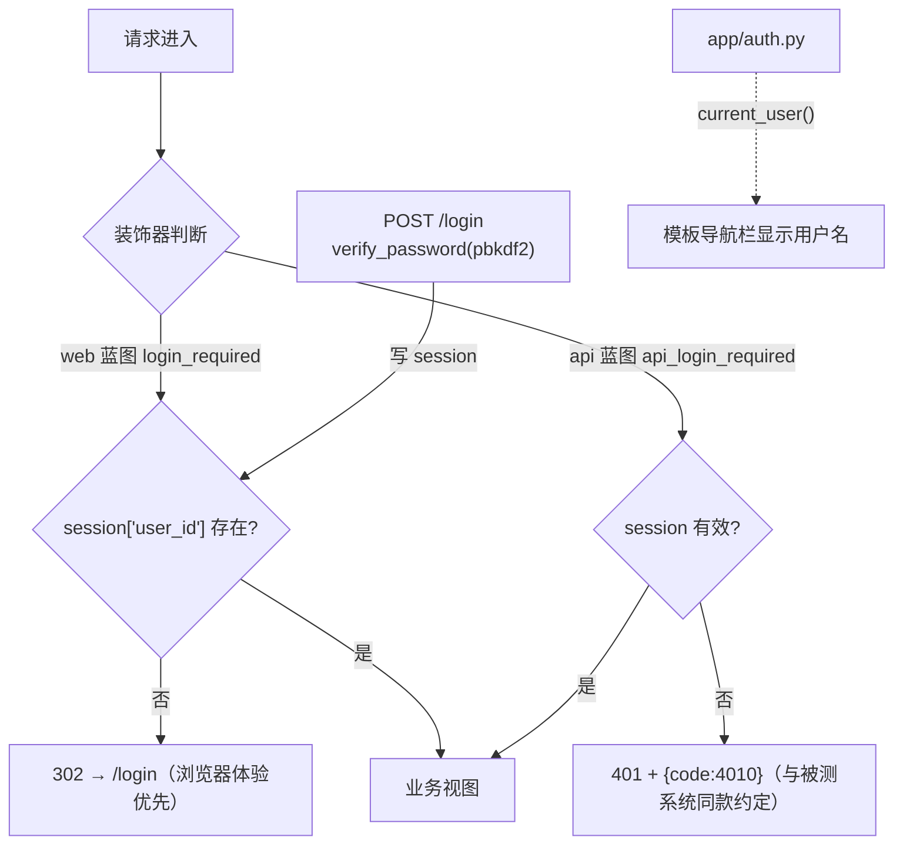

# test-platform · 文档03 认证与会话

> 一句话：平台自己的登录用 pbkdf2 + session-cookie，被测系统用 JWT——两套鉴权在同一篇里对比着讲，装饰器怎么把"访问控制"从业务代码里剥出去。

## 1. 在整个平台中的位置

认证是所有页面的**门卫**：web 蓝图每个路由、api 蓝图除登录外每个端点，都被装饰器包住。



## 2. 涉及文件

| 文件 | 内容 |
|---|---|
| `app/auth.py` | hash_password / verify_password / current_user / login_required / api_login_required |
| `app/api/__init__.py` | POST /api/login、/api/logout、/api/me（登录入口与校验演示） |
| `app/web/__init__.py` | GET/POST /login、/logout（表单登录 + flash） |
| `config.py` | SECRET_KEY（session cookie 签名密钥） |
| `tests/test_web_api.py` | TestAuth 类：未登录 302/401、错密码业务码、登录登出闭环 |

## 3. 如何实现

### 3.1 pbkdf2 密码摘要（比 demo-mall 的简化版更"真"）

demo-mall 教学版是固定盐单轮 hmac；平台存的是真实管理员密码，按 OWASP 推荐用 pbkdf2：

```python
PBKDF2_ITERATIONS = 120_000   # 越高越难暴破；本机约几十毫秒，登录场景无感

def hash_password(password: str) -> str:
    salt = secrets.token_hex(16)                       # 每个密码独立随机盐
    digest = hashlib.pbkdf2_hmac(
        "sha256", password.encode("utf-8"), bytes.fromhex(salt), PBKDF2_ITERATIONS)
    return f"pbkdf2$sha256${PBKDF2_ITERATIONS}${salt}${digest.hex()}"

def verify_password(password: str, stored: str) -> bool:
    try:
        _algo, _hash_name, iterations, salt_hex, digest_hex = stored.split("$")
        digest = hashlib.pbkdf2_hmac(
            "sha256", password.encode("utf-8"), bytes.fromhex(salt_hex), int(iterations))
        return hmac.compare_digest(digest.hex(), digest_hex)
    except (ValueError, AttributeError):
        return False       # 摘要串格式不对一律"校验失败"，不外泄格式信息
```

三个要点：
- **随机盐**（`secrets.token_hex`）：同样的密码每次摘要不同，彩虹表失效；
- **参数随摘要串自描述**（`pbkdf2$sha256$120000$盐$哈希`）：将来提高迭代次数，老密码仍能按旧参数校验、成功登录后透明重哈希，不需要"全员重置密码"；
- **`hmac.compare_digest` 恒定时间比较**：防时序攻击（普通 `==` 在第一个不同字节就返回，可被逐字节探测）。

### 3.2 session 登录态

```python
# 登录成功（api 蓝图）：
session["user_id"] = user["id"]

# 每次请求取当前用户（模板导航栏也用它）：
def current_user():
    user_id = session.get("user_id")
    if not user_id:
        return None
    return query_one("SELECT id, username FROM users WHERE id = ?", (user_id,))
```

Flask 的 session 是**签名 cookie**：数据存在浏览器端，但用 SECRET_KEY 签名，改了内容签名就对不上——单机部署下它等价于"服务端 session"的体验，且零存储。SECRET_KEY 泄露 = 伪造任意登录态，所以生产要从环境变量注入（config.py 注释里写明了）。

### 3.3 双装饰器：页面与 API 各管一摊

```python
def login_required(view):
    """页面蓝图专用：未登录 302 到 /login（浏览器体验优先）。"""
    @wraps(view)
    def wrapper(*args, **kwargs):
        if not session.get("user_id"):
            return redirect(url_for("web.login"))
        return view(*args, **kwargs)
    return wrapper

def api_login_required(view):
    """API 蓝图专用：未登录 401 + {"code":4010}。"""
    @wraps(view)
    def wrapper(*args, **kwargs):
        if not session.get("user_id"):
            return jsonify({"code": 4010, "message": "未登录或会话已过期", "data": None}), 401
        return view(*args, **kwargs)
    return wrapper
```

- `@wraps` 不能少：保留被装饰函数的 `__name__`，否则 Flask 路由注册时两个同名 wrapper 会撞名；
- 401 响应体**刻意与被测系统 demo-mall 同构**（HTTP 401 + code 4010）——平台自己也是一套被测系统，测试它的代码（tests/test_web_api.py）写起来和测被测系统一模一样；
- 登录失败的业务码沿用 1001/1002 区分（教学平台保留区分便于演示业务码断言；真实系统通常合并为一条防撞库，代码注释里写明了这个取舍）。

### 3.4 session vs JWT：平台场景的对比

| 维度 | session-cookie（平台选它） | JWT（被测系统用它） |
|---|---|---|
| 登出/吊销 | `session.clear()` 立即生效 | 需黑名单（demo-mall 的 revoke 模拟） |
| 服务端存储 | 签名 cookie 自包含，服务端零存储 | 无状态，吊销难 |
| 浏览器携带 | 自动，HttpOnly 防 XSS 偷取 | 前端手动放 header，易成 XSS 目标 |
| 跨服务/移动端 | 弱（cookie 域绑定） | 强（header 自带） |
| 适用场景 | 服务端渲染多页应用 | API-only、多端、水平扩展 |

结论一句话：**页面对人的场景 session 最省事，开放 API 对机的场景 JWT 才有价值**。被测系统用 JWT 是因为它要练"token 关联/401 自动重登"；平台用 session 是因为它的用户就是浏览器里的人。

## 4. 为什么这样设计（决策复盘）

| 决策 | 选择 | 备选 | 理由 |
|---|---|---|---|
| 密码摘要 | pbkdf2 12 万次 + 随机盐 | demo-mall 式单轮 hmac / bcrypt | 标准库零依赖即可达标；bcrypt 需要额外安装，原理相同 |
| 会话 | Flask 签名 cookie session | 平台发 JWT / 服务端 session 表 | 多页应用最简；登出即失效 |
| 未登录口径 | 页面 302 / API 401+4010 | 统一 401 | 浏览器要重定向体验，fetch 要可判定的 JSON |
| 双装饰器而不是参数 | 两个独立装饰器 | login_required(redirect=False) | 显式命名即文档；两处逻辑将来会分叉 |
| 登录失败提示 | 区分 1001/1002 | 合并提示 | 教学演示业务码断言；真实系统应合并（代码注释已注明） |

## 5. 怎么运行验证（真实输出）

```bash
# 1) 未登录访问页面 → 302
curl -s --noproxy "*" -o /dev/null -w "%{http_code} %{redirect_url}\n" http://127.0.0.1:8000/projects
# 302 http://127.0.0.1:8000/login

# 2) 未登录调 API → 401 + 4010
curl -s --noproxy "*" http://127.0.0.1:8000/api/projects
# {"code":4010,"message":"未登录或会话已过期","data":null}

# 3) 错密码 → 业务码 1002
curl -s --noproxy "*" -X POST http://127.0.0.1:8000/api/login \
     -H "Content-Type: application/json" -d '{"username":"admin","password":"nope"}'
# {"code":1002,"message":"密码错误","data":null}

# 4) 正确登录 → session cookie
curl -s --noproxy "*" -c cookies.txt -X POST http://127.0.0.1:8000/api/login \
     -H "Content-Type: application/json" -d '{"username":"admin","password":"admin123"}'
# {"code":0,"message":"ok","data":{"id":1,"username":"admin"}}
```

自动化验证（tests/test_web_api.py::TestAuth，6 条）：

```
tests/test_web_api.py::TestAuth::test_health_no_auth PASSED
tests/test_web_api.py::TestAuth::test_login_page_has_form PASSED
tests/test_web_api.py::TestAuth::test_page_redirects_when_not_logged_in PASSED
tests/test_web_api.py::TestAuth::test_api_returns_4010_when_not_logged_in PASSED
tests/test_web_api.py::TestAuth::test_login_wrong_password_code_1002 PASSED
tests/test_web_api.py::TestAuth::test_login_logout_flow PASSED
```

## 6. 常见坑

1. **装饰器忘写 `@wraps`**：Flask 按函数名注册路由，两个被装饰视图都叫 `wrapper` → 启动报"视图名冲突"，而且报错指向装饰器本身很难看懂。
2. **SECRET_KEY 每次重启随机生成**：session cookie 签名失效，用户重启一次全员被登出——密钥必须是稳定配置。
3. **把 401 写成 302（或反之）**：fetch 拿到 302 会"跟着跳到登录页 HTML"，前端解析 JSON 报错；API 装饰器必须返回 JSON 401，页面装饰器才 302。
4. **password_hash 列加了 UNIQUE**：不同用户同密码不同盐，摘要必然不同，加 UNIQUE 毫无意义还会误导后人——约束要跟着语义走。
5. **明文密码进了日志**：登录接口的 request body 打日志时忘了脱敏，密码全进日志文件——平台的所有出站快照都做了 Authorization 脱敏（见文档05/06），入站日志同样要警惕。

## 7. 面试怎么讲（30 秒 + 3 追问）

**30 秒版本**：
"平台认证是三层：pbkdf2 带随机盐 12 万次迭代存密码摘要，参数自描述在摘要串里所以能平滑升级；会话用 Flask 签名 cookie，登出即失效；访问控制拆成两个装饰器——页面未登录 302 去 /login，API 未登录返回 401 加业务码 4010，后者刻意和被测系统同构，平台自己的测试代码就能复用同一套断言思路。"

**追问 1：为什么平台不用 JWT，和被测系统统一？**
"场景不同：平台的用户是浏览器里的人，session-cookie 的 HttpOnly、登出即失效、零前端管理都是白拿的好处；JWT 的价值在无状态横向扩展和多端携带，单机教学平台一个都用不上。被测系统用 JWT 恰恰是为了练 token 关联和 401 重登。"

**追问 2：pbkdf2 的迭代次数怎么定？**
"两个约束相乘：单次校验耗时（登录无感，几十毫秒内）和离线暴破成本。12 万次在本机 pbkdf2-sha256 大约几十毫秒。关键设计是把迭代次数写进摘要串，硬件升级后提高次数，老密码按旧参数校验、登录时透明重哈希。"

**追问 3：装饰器里 `@wraps` 不加会怎样？**
"被装饰函数的 __name__ 变成 wrapper，Flask 路由注册时多个视图撞名直接报错。这是装饰器三件套（wraps/参数透传/返回值透传）里最容易省略又必炸的一个，我的测试覆盖了页面 302 和 API 401 两条路径，装饰器出问题会在 CI 就炸而不是上线后。"

## 8. 复现任务清单

- [ ] 手写两个装饰器（不看源码），跑 `pytest tests/test_web_api.py::TestAuth -v` 验证
- [ ] 把 `PBKDF2_ITERATIONS` 改成 100，观察 hash_password 耗时变化，理解参数含义
- [ ] 临时改掉 config.SECRET_KEY 重启，验证旧 cookie 全部失效（被登出）
- [ ] 用 sqlite3 查看 users 表：同密码两次注册的 password_hash 不同（随机盐生效）
- [ ] 思考题：如果平台要支持"API Token 供 CI 调用"（无浏览器 cookie），你会加什么？（提示：个人 access token + api_login_required 的旁路校验）
