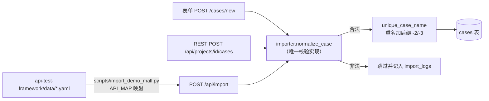

# test-platform · 文档04 用例管理与 YAML 导入

> 一句话：用例的三条入库通道（表单 / REST / YAML 批量导入）共用一套校验函数；导入器把参考框架的数据驱动 YAML 翻译成平台格式，重名不覆盖只加后缀。

## 1. 在整个平台中的位置

用例管理是平台**数据入口**：执行引擎（05）消费的就是这里产出的 cases 表。



## 2. 涉及文件

| 文件 | 内容 |
|---|---|
| `app/importer.py` | normalize_case / unique_case_name / get_or_create_project / import_payload |
| `scripts/import_demo_mall.py` | API_MAP 映射表 + YAML→平台格式转换 + REST 提交 |
| `app/api/__init__.py` | POST /api/import、POST /api/projects/<id>/cases |
| `app/web/__init__.py` | /cases/new、/cases/<id>/edit 表单路由（复用 normalize_case） |
| `tests/test_web_api.py` | TestImport：重名后缀、重复导入同项目、非法字段跳过 |

## 3. 如何实现

### 3.1 平台自有 YAML 格式

```yaml
project:
  name: Demo商城接口
  base_url: http://127.0.0.1:5000
cases:
  - name: [商品] 默认查询第一页商品
    method: GET
    path: /api/goods
    params: {page: 1}
    expect_status: 200
    expect_code: 0
    expect_fields: {"$.data.total": 10}
```

与 api-test-framework 的 YAML 是**映射关系**而非同一种格式：参考框架用 `api: login + params`（URL 藏在 api 层注册表里），平台用 `method + path`（用例直接携带请求定义）。前者为"URL 只出现在 api 层"的分层铁律服务，后者为"用例是自包含数据"的平台化服务——两种取向都对，只是服务的边界不同。

### 3.2 归一化校验：三条入口一份逻辑

```python
def normalize_case(payload: dict) -> tuple[dict | None, str | None]:
    """表单/REST/YAML 三条入口共用；非法返回 (None, 原因)。"""
    name = (payload.get("name") or "").strip()
    if not name:
        return None, "name 不能为空"
    method = (payload.get("method") or "GET").strip().upper()
    if method not in ALLOWED_METHODS:
        return None, f"method 不支持：{method}"
    path = (payload.get("path") or "").strip()
    if not path.startswith("/"):
        return None, "path 必须以 / 开头（相对项目 base_url）"
    ...
    for field in ("headers", "params", "body"):
        text, err = _to_json_text(payload.get(field), field)
        ...
    for field in ("expect_status", "expect_code"):
        value, err = _to_int_or_none(payload.get(field), field)
        ...
```

设计要点：
- **不抛异常**，返回 `(归一化结果, 错误原因)`——表单要 flash 中文提示、API 要 `{"code":1004}`、导入要"跳过并记录"，三种消费者各自渲染，校验层不管展示；
- **JSON 字段"接受 dict 或 JSON 字符串"**（`_to_json_text`）：YAML 进来是原生 dict，表单进来是 textarea 字符串，入库前统一序列化成紧凑 JSON 文本；
- **expect_status/expect_code 过 `_to_int_or_none`**：表单提交的 "0" 字符串要转成整数 0，且 0 必须保留（不能被当空值吞掉）。

### 3.3 重名策略：不报错、不覆盖、加后缀

```python
def unique_case_name(project_id: int, name: str) -> str:
    candidate = name
    suffix = 2
    while query_one("SELECT id FROM cases WHERE project_id=? AND name=?",
                    (project_id, candidate)):
        candidate = f"{name}-{suffix}"
        suffix += 1
    return candidate
```

三个候选策略的对比：

| 策略 | 行为 | 问题 |
|---|---|---|
| 报错中断 | 重名即失败 | 51 条里 1 条重名毁掉整批导入 |
| **覆盖更新（多数商业平台的做法）** | 同名即 UPDATE | 悄悄毁掉用户手工调过的用例；"导入"语义不可预测 |
| **加后缀（本平台）** | `-2/-3` 继续 | 用例列表会膨胀；但每次导入都被 import_logs 留痕，可审计 |

选加后缀的理由：批量导入最高频的场景是"补量/重演"而不是"改定义"，改定义应该走编辑页（编辑页改名才会撞 1003 冲突码）。重复导入同一份 YAML 落到**同一个项目**（`get_or_create_project` 按名字 get-or-create），所以同一份文件导两次 = 每条用例出现两份（原版 + 后缀版）——这是文档里明说的行为，不是 bug。

### 3.4 import_payload：批量导入主流程

```python
def import_payload(data: dict, source: str = "") -> dict:
    project_conf = data.get("project") or {}
    project_id = get_or_create_project(project_conf["name"], ...)

    imported, skipped, errors = 0, 0, []
    for raw in data.get("cases") or []:
        case, err = normalize_case(raw)
        if err:
            skipped += 1
            errors.append({"name": ..., "reason": err})
            continue
        case["name"] = unique_case_name(project_id, case["name"])
        case_ids.append(db_insert("INSERT INTO cases(...)", ...))
        imported += 1

    db_insert("INSERT INTO import_logs(project_id, source, imported, skipped, message) ...")
    return {"project_id": ..., "imported": imported, "skipped": skipped, ...}
```

**逐条跳过而不是整批回滚**：50 条里 1 条格式错，不应该让 49 条导不进去；错误明细（哪条、为什么）进返回值和 import_logs.message。

### 3.5 scripts/import_demo_mall.py 的映射表

参考框架的 16 个 api 名（REGISTRY）→ 平台 method/path/params/body 的映射（节选）：

```python
API_MAP = {
    "login":        {"method": "POST", "path": "/api/auth/login", "kind": "body", "need_auth": False},
    "goods_detail": {"method": "GET", "path": "/api/goods/{goods_id}", "kind": "path", "need_auth": False},
    "cart_update":  {"method": "PUT", "path": "/api/cart/items/{item_id}", "kind": "path_body", "need_auth": True},
    "me_with_token": {"method": "GET", "path": "/api/auth/me", "kind": "token_header", "need_auth": False},
    ...
}
```

kind 的含义：
- `query`：params 原样放查询串（goods_list）；
- `body`：params 原样放请求体（login/order_create）；
- `path`：资源 id 拼进路径（`/api/goods/{goods_id}`.format(**params)）；
- `path_body`：路径带 id + body 带其余字段（cart_update）；
- `token_header`：显式把（伪造的）token 放 Authorization 头（me_with_token——依赖平台"用例 headers 优先于自动登录"的约定）。

`no_auth: true` → 不设 auth_user；否则 need_auth=True 的 api 统一配 `auth_user=lemon`——执行时由平台的自动登录机制换 token（见文档05）。

**链路用例跳过**：chain_data.yaml 的用例带 `steps + extract`（一条用例多个步骤、变量提取传递），v1 执行引擎按"单请求单断言集"设计，跳过 4 条并在输出中计数说明——这是 v2 多步编排的演进方向，不是能力缺陷。

### 3.6 导入脚本为什么走 REST 而不是直接写库

| 方案 | 优点 | 缺点 |
|---|---|---|
| **REST（选它）** | 只依赖平台 HTTP 契约；顺带集成测试了 /api/login、/api/import；校验/去重逻辑单一实现 | 多一跳 HTTP（毫秒级，无所谓） |
| 直接写 SQLite | 少一层 | 脚本绑定平台内部 schema 与 DB 路径；重名校验逻辑要抄一份，必然漂移；平台换机器/换库脚本全废 |

## 4. 为什么这样设计（决策复盘）

| 决策 | 选择 | 备选 | 理由 |
|---|---|---|---|
| 用例格式 | 平台自有格式 + 导入器映射 | 直接兼容参考框架 YAML | 参考框架格式依赖"api 注册表"这个代码概念，平台用例必须自包含 |
| 校验 | 单函数 normalize_case | 每入口各写一套 | 校验漂移 = 同一用例三个入口三种判定 |
| 重名 | 加后缀 | 报错/覆盖 | 导入是补量语义；覆盖会毁手工调整 |
| 非法用例 | 跳过 + 留痕 | 整批回滚 | 批量操作容错优先 |
| 链路用例 | v1 跳过 | 简化支持 | 多步编排是执行引擎级特性，硬塞会污染 v1 模型 |
| 导入通道 | REST API | 直写库 | 解耦 + 狗粮 + 单一实现 |

## 5. 怎么运行验证（真实输出）

```bash
python scripts/import_demo_mall.py --url http://127.0.0.1:8000 --api-base http://127.0.0.1:5000
```

```
[1/3] 已登录平台 http://127.0.0.1:8000（admin）
  cart_data.yaml: 转换 13 条，跳过 0 条
  chain_data.yaml: 转换 0 条，跳过 4 条
  goods_data.yaml: 转换 14 条，跳过 0 条
  login_data.yaml: 转换 12 条，跳过 0 条
  order_data.yaml: 转换 12 条，跳过 0 条
[2/3] 转换完成：待导入 51 条，跳过 4 条（链路用例）
[3/3] 导入完成：成功 51 条，跳过 0 条，项目 id=1
```

再导一次验证重名后缀（预期每条 +1 份带 `-2` 的副本）：

```bash
python scripts/import_demo_mall.py --url http://127.0.0.1:8000 --api-base http://127.0.0.1:5000
# [3/3] 导入完成：成功 51 条，跳过 0 条，项目 id=1
# 用例列表出现 "[认证] 正确账号密码登录成功-2" 等
```

自动化验证：

```
tests/test_web_api.py::TestImport::test_import_and_dedup PASSED        # 重名-2 + 非法跳过
tests/test_web_api.py::TestImport::test_import_twice_same_project PASSED  # 重复导入同项目
```

## 6. 常见坑

1. **YAML 里的路径参数没转义**：`"/api/goods/{goods_id}".format(**params)` 遇到 params 缺 goods_id 会 KeyError——映射层的 kind=path 必须保证参数在，缺参应算"转换失败"而不是崩溃。
2. **`expect_code: 0` 在 YAML 里被当 falsy**：转换层写 `if expect.get("code"):` 会把 0 丢掉，入库变"没配业务码断言"——必须 `in` 判断键存在。
3. **中文键值乱码**：json.dumps 忘了 `ensure_ascii=False`，入库变成 `\u5bc6\u7801\u9519\u8bef`，报告页断言期望值显示成转义串（不影响判定，影响可读性）。
4. **重复导入把项目 base_url 冲掉**：第二次导入不带 base_url 时，`get_or_create` 已存在的项目 base_url 被覆盖成空——平台只在"项目原 base_url 为空"时才补写，不覆盖已配置环境。
5. **表单 expect_code 输入 "0" 变 None**：表单字符串过 `_to_int_or_none` 时把 "" 和 "0" 混为一谈，0 断言悄悄丢失——空串和零必须分开判。

## 7. 面试怎么讲（30 秒 + 3 追问）

**30 秒版本**：
"用例有三条入库通道——网页表单、REST API、YAML 批量导入——全部走同一个校验函数做归一化，保证'同一用例三个入口判定一致'。我写了一个演示导入器，把 pytest 框架的数据驱动 YAML 通过一张 api 映射表翻译成平台格式，51 条用例包括路径参数、显式伪造 token 头、no_auth 反向用例都无损转换；重名不覆盖只加后缀，非法用例逐条跳过并写导入日志。"

**追问 1：重名为什么加后缀而不是覆盖？**
"导入语义是补量不是改定义。覆盖会悄悄毁掉用户手工调整过的用例，而且用户发现不了；报错会让 51 条里 1 条重名毁掉整批。加后缀 + import_logs 留痕是最可审计的折中，要改定义走编辑页。"

**追问 2：参考框架的链路用例（多步骤）为什么跳过？**
"链路用例的本质是'多步编排 + 变量提取'，比如登录提取 token 供后续步骤引用。v1 的执行引擎按单请求设计、并发执行要求用例无状态，硬塞链路会破坏并发模型。steps+extract 的设计我已经在参考实现里验证过，放到 v2 做编排执行器是最稳的演进路径。"

**追问 3：导入脚本为什么调 API 不直接写库？**
"三个理由：解耦——脚本只依赖 HTTP 契约，平台换机器换库脚本零改动；狗粮——导入本身就是对 /api/login 和 /api/import 的集成测试；单一实现——重名后缀和字段校验只在平台有一份，直写库必须抄一份必然漂移。"

## 8. 复现任务清单

- [ ] 对照 api_registry.py 的 REGISTRY，手工把 `goods_detail` 一条用例从 YAML 翻译成平台格式
- [ ] 运行导入脚本两次，用 sqlite3 验证 cases 行数 54→108、import_logs 新增一行
- [ ] 在 API_MAP 里加一个新接口（如 `POST /api/test/reset`），导入一条"重置数据"用例并执行
- [ ] 故意把一条 YAML 的 expect_code 删掉再导入，对比转换前后断言层数
- [ ] 给 normalize_case 加一条规则：path 不允许包含 `..`（防路径穿越），并补一条单测
- [ ] 思考题：如果要支持"导入即覆盖"模式（幂等导入），schema 和 normalize_case 要怎么变？（提示：给用例加业务唯一键 external_id）
