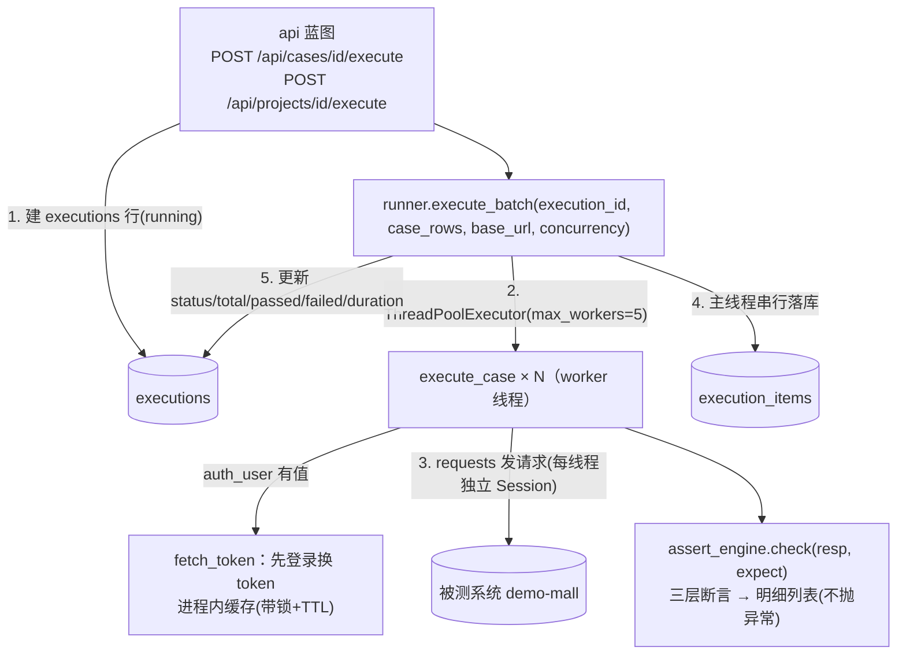

# test-platform · 文档05 执行引擎

> 一句话：平台的心脏——从一条用例定义到"真实 HTTP 请求 + 三层断言明细 + 快照落库"的全过程，以及为什么"断言不抛异常""HTTP 并发但落库串行""永不中断批次"。

## 1. 在整个平台中的位置

执行引擎是唯一**对外发起请求**的模块，也是断言引擎（assert_engine）唯一的调用方：



## 2. 涉及文件

| 文件 | 内容 |
|---|---|
| `app/runner.py` | execute_case / execute_batch / fetch_token / _send / _mask_headers / build_expect_from_case |
| `app/assert_engine.py` | parse_body / extract_jsonpath / check（全部不抛异常） |
| `config.py` | EXECUTION_CONCURRENCY / REQUEST_TIMEOUT / TOKEN_TTL_SECONDS / SNAPSHOT_BODY_LIMIT |
| `tests/test_runner.py` | 单测 8 条（mock _send）+ 集成 2 条（真实 mall） |

## 3. 如何实现（逐函数精讲）

### 3.1 线程基础设施：每线程一个 Session

```python
_thread_local = threading.local()

def _get_session() -> requests.Session:
    session = getattr(_thread_local, "session", None)
    if session is None:
        session = requests.Session()
        session.trust_env = False        # 关键：无视系统代理
        _thread_local.session = session
    return session

def _send(method, url, *, params=None, json_body=None, headers=None, timeout=None):
    """所有出站 HTTP 的唯一出口（方便测试 monkeypatch，也方便统一加埋点）。"""
    return _get_session().request(method, url, params=params, json=json_body,
                                  headers=headers, timeout=timeout or config.REQUEST_TIMEOUT)
```

两个"为什么"：
- **Session 复用 TCP 连接**：批量 50 条请求到同一台被测系统，不复用连接就是 50 次 TCP 握手；
- **为什么每线程一个而不是全局一个**：requests.Session 官方不保证线程安全（cookie jar 有竞态），threading.local 让 5 个 worker 各持各的——用最小代价绕开整类问题；
- **trust_env=False**：Windows 系统代理（如 127.0.0.1:7897）开着时，requests 默认读环境变量/注册表代理设置，把发往 `127.0.0.1:5000` 的请求也丢给代理，轻则慢重则连不上。平台只打内网被测系统，直接禁用。

`_send` 被抽成模块级函数还有个用途：单测里 `monkeypatch.setattr(runner, "_send", fake)` 就能全链路测试引擎，一个真 HTTP 包都不用发。

### 3.2 token 自动登录与缓存

```python
_token_cache: dict[tuple, tuple[str, float]] = {}   # {(base_url, user, pass): (token, 过期时刻)}
_token_lock = threading.Lock()

def fetch_token(base_url, username, password) -> str:
    key = (base_url.rstrip("/"), username, password)
    with _token_lock:
        cached = _token_cache.get(key)
        if cached and cached[1] > time.time():
            return cached[0]
        resp = _send("POST", key[0] + "/api/auth/login",
                     json_body={"username": username, "password": password})
        body = assert_engine.parse_body(resp)
        token = (body or {}).get("data", {}).get("token") if isinstance(body, dict) else None
        if not token:
            return ""          # 登录失败不抛异常：用例会收到 401，断言明细自然失败
        _token_cache[key] = (token, time.time() + config.TOKEN_TTL_SECONDS)
        return token
```

- **锁内"查缓存→登录→写缓存"**：并发批量时 50 条用例同时发现没缓存，不加锁就是 50 次登录请求——浪费还可能触发被测系统限流；
- **TTL 1500 秒**：demo-mall token 有效期 1800 秒，留 5 分钟余量，避免"缓存还剩 10 秒过期、请求发出时恰好 401"的边界；
- **登录失败返回空串**而不是抛异常：错误顺着既有链路走（用例收到 401 → 断言失败 → 明细显示），不为登录失败单开一条错误通道；
- 进程内 dict 而不是数据库：token 是短时效凭证，重启即失效，单进程部署 dict 就是最简方案。水平扩容时才换 Redis。

execute_case 里应用 token 时用 `setdefault`：

```python
if case.get("auth_user"):
    token = fetch_token(base_url, case["auth_user"], case.get("auth_pass") or "")
    headers.setdefault("Authorization", f"Bearer {token}")
```

`setdefault` 的语义：**用例显式写的 Authorization 优先**——"伪造 token 被拒绝"这类用例必须发假 token，不能被自动登录顶掉（tests 里有专门回归用例）。

### 3.3 execute_case：一条用例的一生

```python
def execute_case(case: dict, base_url: str, timeout=None) -> dict:
    result = {"case_id": ..., "passed": False, "status_code": None, "asserts": [], ...}
    try:
        # 1) JSON 文本反序列化：库里 headers/params/body 是文本，读出要 loads
        headers = _load_json_field(case.get("headers")) or {}
        params  = _load_json_field(case.get("params"))
        body    = _load_json_field(case.get("body"))

        # 2) 鉴权自动化（setdefault 保序）
        if case.get("auth_user"):
            token = fetch_token(...)
            headers.setdefault("Authorization", f"Bearer {token}")

        # 3) 计时发请求
        start = time.perf_counter()
        resp = _send(method, url, params=params, json_body=body, headers=headers, timeout=timeout)
        result["duration_ms"] = round((time.perf_counter() - start) * 1000)

        # 4) 三层断言：结构化明细，不抛异常
        expect = build_expect_from_case(case)
        asserts = assert_engine.check(resp, expect)
        result["asserts"] = asserts
        result["passed"] = assert_engine.all_passed(asserts)
        result["status_code"] = resp.status_code
        result["resp_code"] = assert_engine.parse_body(resp).get("code")  # 非 JSON 响应时 None

        # 5) 快照：请求脱敏 + 响应截断
        result["request_snapshot"]  = json.dumps({"method":..., "url":...,
            "headers": _mask_headers(headers), "params":..., "body":...}, ensure_ascii=False)
        result["response_snapshot"] = json.dumps({"status_code":...,
            "body": resp.text[:config.SNAPSHOT_BODY_LIMIT]}, ensure_ascii=False)
    except requests.RequestException as exc:
        # 网络层失败：转成"网络请求"失败明细，批次继续
        result["asserts"] = [{"item": "网络请求", "expected": "响应可达",
                              "actual": str(exc)[:300], "passed": False,
                              "message": f"请求未到达被测系统：{exc.__class__.__name__}"}]
    except Exception as exc:
        # 兜底：用例定义的脏数据也不能拖垮批次
        result["asserts"] = [{"item": "用例执行", ..., "passed": False}]
    return result
```

**"永不抛异常"是硬要求**：50 条并发跑，1 条构造请求时抛 KeyError，如果异常冒出来，整个 future 收集被打断、其余 49 条结果全丢。把一切错误降级为"失败断言明细"后，批次永远完整收口。三层 except 分工：

| 异常 | 分类 | 明细 item |
|---|---|---|
| requests.RequestException（连不上/超时） | 环境问题 | `网络请求` |
| 其他一切（脏数据/代码 bug） | 用例/平台问题 | `用例执行` |
| 正常响应里的断言不满足 | 被测系统行为 | `HTTP状态码`/`业务code`/`字段 xxx` |

`build_expect_from_case` 里藏着一个必讲的坑：

```python
if case.get("expect_code") is not None:    # ✅ 必须这样
    expect["code"] = case["expect_code"]
# ❌ if case.get("expect_code"): —— 把 0 当成"没配"，业务码断言悄悄消失
```

expect_code=0 是最高频的合法期望值，`if code:` 的写法让"三层断言"在成功用例上变成两层，且报告上完全看不出异常。tests/test_runner.py 的 `test_expect_code_zero_must_not_be_ignored` 是这条的回归用例。

### 3.4 assert_engine.check：断言为什么返回明细而不是抛异常

```python
def check(resp, expect=None) -> list[dict]:
    results, body = [], parse_body(resp)
    if expect.get("status_code") is not None:
        results.append(_make_item("HTTP状态码", expect["status_code"], resp.status_code,
                                  resp.status_code == expect["status_code"]))
    if expect.get("code") is not None:
        if body is None:
            results.append(_make_item("业务code", expect["code"], None, False, "响应体不是合法JSON"))
        else:
            results.append(_make_item("业务code", expect["code"], body.get("code"),
                                      body.get("code") == expect["code"]))
    for expr, expected in (expect.get("fields") or {}).items():
        ...   # JSONPath 未命中/命中比较，同样进 results
    return results
```

| | pytest 版 assert_response | 平台版 check |
|---|---|---|
| 失败行为 | 第一处失败 raise AssertionError | 全部执行，逐条返回 |
| 输出 | 控制台堆栈（人看） | `[{item, expected, actual, passed, message}]`（机器渲染） |
| 信息量 | 一条报错 | 每层断言的期望/实际/原因 |
| 适用 | "用例失败即终止"的 CI 门禁 | "报告要展示全貌"的在线平台 |

"三层全部执行"的价值举例：一个接口挂了，状态码 500、code 缺失、字段也错——pytest 版只能看到第一层的断言失败，平台版报告直接告诉你"状态码期望 200 实际 500、code 断言因非 JSON 跳判、2 个字段断言未命中"，一次执行看全所有现场。

JSONPath 提取有个实现细节：

```python
def extract_jsonpath(data, expr):
    matches = jsonpath(data, expr)
    return matches[0] if matches else None   # 库"未命中"返回 False 而非 None，必须真值判断
```

已知局限（文档如实记录）：字段值本身是 JSON null 时也会被当成"未命中"。教学平台与参考实现保持一致，接受这个局限。

### 3.5 execute_batch：并发调度 + 串行落库

```python
def execute_batch(execution_id, case_rows, base_url, concurrency=None) -> dict:
    start = time.perf_counter()
    results = [None] * len(case_rows)                    # 保序：报告按用例 id 稳定展示
    with ThreadPoolExecutor(max_workers=max(1, concurrency)) as pool:
        future_to_idx = {pool.submit(execute_case, case, base_url): i
                         for i, case in enumerate(case_rows)}
        for future in as_completed(future_to_idx):
            idx = future_to_idx[future]
            try:
                results[idx] = future.result()
            except Exception as exc:                     # 双保险：平台自身 bug 也不中断批次
                results[idx] = {"passed": False, "asserts": [{"item": "调度", ...}], ...}

    # 落库：全部跑完才写，且只在调用线程写
    for r in results:
        db_insert("INSERT INTO execution_items(...) VALUES(...)", (...))
    status = "done" if failed == 0 else "failed"
    db_execute("UPDATE executions SET status=?, total=?, passed=?, failed=?, duration_ms=? WHERE id=?", ...)
    return {"status": status, "total": ..., "passed": ..., "failed": ..., "duration_ms": ...}
```

并发模型一句话：**HTTP 请求在 worker 线程并发（瓶颈是网络 IO，线程池正合适），SQLite 落库在调用线程串行（sqlite3 连接不能跨线程）**。"并发 IO、串行写库"用最简单的模型同时规避了两个线程安全问题。

用例间无共享状态是并发的前提，也因此平台要求用例**默认无状态**：不依赖执行顺序、不依赖其他用例留下的数据（如"先加购再查购物车"）。有链路需求的场景属于 v2 的多步编排。 traded 的能力是"链路场景"，换来的是：任意子集重跑、任意并发度、失败用例单独重跑全部有效。

### 3.6 同步执行 vs 异步任务队列（演进讨论）

| 阶段 | 方案 | 触发条件 |
|---|---|---|
| **v1（现状）** | API 请求内同步执行（几百条、秒级） | — |
| v1.5 | 后台线程执行 + 前端轮询 `GET /api/executions/<id>` 的 status=running | 单批用例数上千、超过 HTTP 超时 |
| v2 | RQ/Celery + Redis，execute_batch 原样搬进 worker；executions.status 语义即任务状态 | 定时任务/多实例 |
| v3 | worker 水平扩容 + token 缓存/结果回写走 Redis + 限流 | 团队级平台 |

关键：v1 的两个设计决定让演进是加法不是重写——①"建 executions 行"与"跑批"分离（execute_batch 接收现成的 execution_id）；②execute_case 是纯函数（不碰 DB/Flask 上下文），天然可搬进任何 worker。

## 4. 为什么这样设计（决策复盘）

| 决策 | 选择 | 备选 | 理由 |
|---|---|---|---|
| 断言输出 | 结构化明细不抛异常 | assert 抛异常 | 报告要"每条断言过没过"的全貌，不是第一处失败的堆栈 |
| 执行异常 | 全部降级为失败明细 | 让异常传播 | 单条脏数据不能拖垮 50 条批次 |
| 并发单元 | 线程池（5） | asyncio / 多进程 | IO 密集同步 requests 下线程池最直接；asyncio 要全链路 async 化，收益不成比例 |
| 落库时机 | 批次完成统一写 | worker 内实时写 | sqlite 跨线程限制 + 简化；代价是批次中途看不到进度（v1.5 再说） |
| token | 进程内 dict + 锁 + TTL | 每请求现登 / Redis | 短时效凭证配进程内缓存；重复登录被锁合并成 1 次 |
| 计时 | perf_counter 包住整个请求 | resp.elapsed | elapsed 只到响应头，不含 body 下载；perf_counter 是真实用户视角 |
| 快照 | 请求脱敏 + 响应截断 4000 字符 | 全文入库 | 报告会被截图分享，token 泄露是真实事故源 |

## 5. 怎么运行验证（真实输出）

单条用例（未登录场景，无需 token）：

```json
{
 "case_name": "[购物车] 未登录查询购物车被拒绝",
 "passed": 1, "status_code": 401, "resp_code": 4010, "duration_ms": 3,
 "request_snapshot": {"method": "GET", "url": "http://127.0.0.1:5000/api/cart",
                      "headers": {}, "params": null, "body": null},
 "response_snapshot": {"status_code": 401, "body": "{\"code\":4010,...\"message\":\"未登录或 token 无效/过期\"}"},
 "asserts": [
   {"item": "HTTP状态码", "expected": 401,  "actual": 401,  "passed": true},
   {"item": "业务code",  "expected": 4010, "actual": 4010, "passed": true}
 ]
}
```

自动登录场景——请求头里的 token 已脱敏：

```json
{
 "case_name": "[购物车] 登录后查询购物车结构正常",
 "request_snapshot": {"headers": {"Authorization": "Bearer ****MJxvGc"}, ...},
 "asserts": [
   {"item": "HTTP状态码", "expected": 200, "actual": 200, "passed": true},
   {"item": "业务code",   "expected": 0,   "actual": 0,   "passed": true},
   {"item": "字段 $.data.count", "expected": 0, "actual": 0, "passed": true}
 ]
}
```

54 条并发批量（5 线程）：

```
[3] 批次 #2: status=done total=54 passed=54 failed=0 duration=255ms
```

测试验证：

```
tests/test_runner.py::TestExecuteCase::test_token_cached_across_cases PASSED   # 登录只发生 1 次
tests/test_runner.py::TestExecuteCase::test_explicit_authorization_wins PASSED # 伪造 token 优先
tests/test_runner.py::TestExecuteCase::test_network_error_degrades_to_failed_item PASSED
tests/test_runner.py::TestExecuteCase::test_expect_code_zero_must_not_be_ignored PASSED
tests/test_runner.py::TestAgainstRealMall::test_execute_batch_concurrent PASSED
```

## 6. 常见坑

1. **`if expect_code:` 吞掉 0**：本文 3.3 的重点回归项——症状是"成功用例只断言了状态码"，且报告看不出任何异常。
2. **sqlite3 连接跨线程**：把 `get_db()` 拿进 worker 会得到 `SQLite objects created in a thread can only be used in that same thread`；本平台的规避法是"worker 只发 HTTP，落库回主线程"。
3. **requests.Session 全局共享**：官方不保证线程安全，高并发下偶发 cookie 串号；threading.local 每线程一个。
4. **Windows 代理劫持 localhost**：症状是"curl 通、requests 慢或超时"；`session.trust_env = False` 或设置 `NO_PROXY=127.0.0.1`。
5. **time.time() 当计时器**：系统对时会导致耗时为负或跳变；测量耗时用 `time.perf_counter()`（单调时钟）。
6. **token 缓存永不失效**：被测系统改密码/token 策略后平台一直用旧 token 全军覆没 401；TTL 必须略小于被测系统 token 有效期，并暴露 clear_token_cache。

## 7. 面试怎么讲（30 秒 + 3 追问）

**30 秒版本**：
"执行引擎三件事：①execute_case 是纯函数，从用例定义构造请求、auth 配置自动登录换 token（进程内缓存带锁带 TTL）、三层断言返回结构化明细——刻意不抛异常，网络错误和脏数据都降级成失败明细，保证批次永远完整收口；②execute_batch 用线程池并发发请求（每线程独立 Session），落库回主线程串行做，同时规避 sqlite 跨线程和 Session 竞态；③批量结果统一写 execution_items 并更新批次汇总，报告按这个数据渲染每条用例的快照与断言明细。54 条用例并发跑完 250ms 左右。"

**追问 1：为什么断言不抛异常？和 pytest 版差在哪？**
"pytest 的 assert 面向'人看日志'，第一处失败抛 AssertionError 是 fail fast 的正确语义；平台报告面向'机器渲染'，要展示这条用例 5 条断言里哪几条过、哪几条挂、期望多少实际多少——抛异常的话后面的断言永远没机会执行，用户只能重跑看下一条。三层断言全部执行、逐条返回，一次执行看全所有现场。"

**追问 2：为什么用线程池不用 asyncio？**
"瓶颈是网络 IO，线程池够用且改动最小：requests 是同步库，asyncio 要把整条链路（包括将来可能的中间件）async 化，复杂度翻倍收益不匹配。我的并发模型刻意做成'HTTP 并发、落库串行'，一次解决 sqlite 跨线程和 Session 竞态两类问题。真要上量，换 httpx.AsyncClient 是局部替换，execute_case 的纯函数设计让这个替换只动一个函数。"

**追问 3：这个设计怎么演进到异步任务队列？**
"两个预留：executions.status=running 就是任务状态语义，execute_batch 接收现成 execution_id——'建记录'和'跑批'分离，Celery worker 可以直接调 execute_batch；execute_case 纯函数不碰 Flask 上下文，搬进 worker 零改动。所以演进是：同步 → 后台线程+轮询 → Celery+Redis → 水平扩容时 token 缓存换 Redis，每一步都是加法。"

## 8. 复现任务清单

- [ ] 把 execute_case 的 `is not None` 改成真值判断，跑 `pytest tests/test_runner.py -k zero` 看回归用例变红，改回
- [ ] 临时把 `EXECUTION_CONCURRENCY` 改成 1 和 20 各跑一次全量执行，对比 duration_ms，理解并发度与被测系统承受力
- [ ] 在 fetch_token 里打印日志验证"50 条用例只登录 2 次（lemon/test 两账号各一次缓存）"
- [ ] 停掉 demo-mall 后执行一条用例，观察"网络请求"失败明细与批次不中断
- [ ] 手写一遍 check() 的三层断言（不看源码），与 tests/test_assert_engine.py 对拍
- [ ] 思考题：如果被测系统的 token 有效期只有 60 秒，TTL 应该设多少？还要加什么机制？（提示：401 失效重登重放，参考 api-test-framework 的 relogin_hook）
