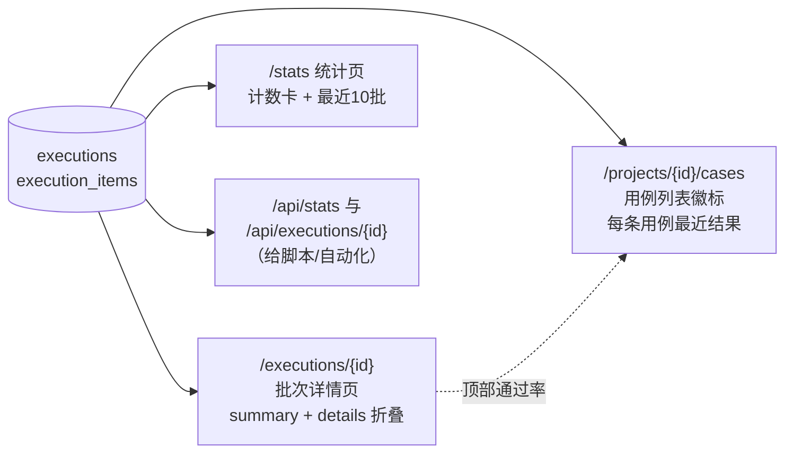

# test-platform · 文档06 报告与统计

> 一句话：报告页为什么每条用例用 `<details>` 折叠、快照里 token 为什么脱敏、通过率的统计口径怎么定——"能看清现场"和"不给未来埋雷"同等重要。

## 1. 在整个平台中的位置

报告与统计是平台**数据出口**：消费 executions/execution_items 两张表，面向三类读者（执行的人、看报告的人、UI 自动化）。



## 2. 涉及文件

| 文件 | 内容 |
|---|---|
| `app/templates/execution_detail.html` | 批次详情：summary 栏 + 每条用例 `<details>`（快照/断言表） |
| `app/templates/cases.html` | 用例列表：最近结果徽标 + 顶部最近批次通过率 |
| `app/templates/executions.html` / `stats.html` | 批次列表 / 统计页 |
| `app/web/__init__.py` | `execution_detail` / `cases` / `stats_page` 路由（数据在路由查好，模板纯展示） |
| `app/api/__init__.py` | `GET /api/stats`、`GET /api/executions/<id>`（同一口径的 JSON 版） |
| `app/runner.py` | `_mask_headers`（快照脱敏）、快照结构定义 |

## 3. 如何实现

### 3.1 快照设计：请求脱敏 + 响应截断

快照在 execute_case 里生成（见文档05），两条规则：

```python
def _mask_headers(headers: dict) -> dict:
    """快照里的请求头脱敏：Bearer token 只留末 6 位便于对账，其余打码。"""
    masked = {}
    for k, v in (headers or {}).items():
        if k.lower() == "authorization" and isinstance(v, str) and len(v) > 12:
            masked[k] = f"{v[:7]}****{v[-6:]}"     # "Bearer ****MJxvGc"
        else:
            masked[k] = v
    return masked
```

- **脱敏**：报告会被截图、分享、贴进工单——完整 token 泄进报告是真实企业出过的事故。保留末 6 位是为了"对账"：能确认发出去的是哪个 token，又不构成可用凭证；
- **截断**：`resp.text[:SNAPSHOT_BODY_LIMIT(4000)]`，防止被测系统吐大 JSON 把库和页面撑爆；截断的是"存储与展示"，断言仍然基于完整响应。

### 3.2 批次详情页：`<details>` 折叠

```html
<div id="exec-summary" class="panel slim summary-bar">
  <span>总数 <strong id="exec-total">{{ execution['total'] }}</strong></span>
  <span>通过 <strong id="exec-passed" class="pass-text">{{ execution['passed'] }}</strong></span>
  <span>失败 <strong id="exec-failed">{{ execution['failed'] }}</strong></span>
  <span>通过率 <strong id="exec-pass-rate">{{ ... }}</strong></span>
  <span>总耗时 <strong id="exec-duration">{{ execution['duration_ms'] }}ms</strong></span>
</div>


<details id="item-{{ it['id'] }}" class="exec-item" open>
  <summary id="item-summary-{{ it['id'] }}">
    <span class="badge {{ 'badge-pass' if it['passed'] else 'badge-fail' }}">{{ '通过' if it['passed'] else '失败' }}</span>
    <span class="strong">{{ it['case_name'] }}</span>
    <span class="muted small mono">HTTP {{ it['status_code'] }} · code {{ it['resp_code'] }} · {{ it['duration_ms'] }}ms</span>
  </summary>
  <div class="exec-item-body">
    <pre id="item-request-{{ it['id'] }}" class="snapshot mono">{{ it['request_snapshot']|tojson_pretty }}</pre>
    <pre id="item-response-{{ it['id'] }}" class="snapshot mono">{{ it['response_snapshot']|tojson_pretty }}</pre>
    <table id="item-asserts-{{ it['id'] }}" class="data-table asserts-table">
      ...每条断言：检查项/期望/实际/✓✗/说明
    </table>
  </div>
</details>

```

**为什么用原生 `<details>` 而不是 JS 手风琴**：

| 方案 | 优点 | 缺点 |
|---|---|---|
| **`<details>`（选它）** | 零 JS；`open` 属性即状态；打印/爬虫友好；可被 `id` 定位跳转 | 展开动画需额外 CSS |
| JS 手风琴 | 动画细腻 | 54 个明细 = 54 份状态管理；"默认展开失败的"要写逻辑 |
| 分页/跳新页 | 每页数据少 | 逐条点开很烦；上下文丢失 |

关键细节：**失败的用例默认 `open`**（`open`）——54 条全绿的批次折叠得干干净净，有失败时打开页面直接就是现场，"优先看现场"。`tojson_pretty` 是 create_app 里注册的 Jinja 过滤器（`json.dumps(value, ensure_ascii=False, indent=2)`），快照以缩进 JSON 直出。

### 3.3 用例列表页：最近结果徽标

"每条用例最近一次执行结果"的取数（web 与 API 同一口径）：

```sql
SELECT ei.* FROM execution_items ei
WHERE ei.id IN (SELECT MAX(id) FROM execution_items GROUP BY case_id)
  AND ei.case_id IN (SELECT id FROM cases WHERE project_id=?)
```

- **为什么按 MAX(id) 取"最近"**：execution_items 自增 id 越大越新，比按 `created_at` 字符串排序可靠（同一秒的两次执行字符串相同，id 永不并列）；
- **单条用例执行也落 executions/execution_items**（total=1 的批次）：徽标、批次列表、统计共用一份口径，不存在"单条执行的结果徽标有、批次统计里没有"的分裂。

页面顶部同时展示最近一次批次通过率（`id="last-pass-rate"`）：项目视角的"健康度"一眼可见。

### 3.4 统计口径

| 指标 | 口径 | 数据来源 |
|---|---|---|
| 批次通过率 | `passed / total`（该批 execution 行） | executions |
| 批次 status | 全部通过=done；有任一失败=failed | runner 落库时计算 |
| 用例耗时 | `perf_counter` 包住单次请求（含 body 下载） | execution_items.duration_ms |
| 批次耗时 | 整批墙钟时间（并发下 ≠ 各用例耗时之和） | executions.duration_ms |
| 累计用例通过/总数 | execution_items 全表 `passed=1` 计数 | stats 页卡片 |
| 用例执行通过/总数（累计） | 注意这是"执行次数"口径，含重跑 | stats 页卡片 |

两个容易含糊的口径在模板里写死了单位与限定词（"累计""最近一次批次"），避免"54 通过"这种无上下文数字引发误读。

### 3.5 数据在路由查好，模板纯展示

```python
@web_bp.get("/executions/<int:execution_id>")
@login_required
def execution_detail(execution_id):
    ...
    from app.api import _item_out          # 复用 API 层解析：JSON 文本 → 对象
    item_dicts = [_item_out(i) for i in items]
    return render_template("execution_detail.html", execution=execution, items=item_dicts)
```

快照/断言的 `json.loads` 统一在路由层完成——模板里写 `json.loads` 是反模式（逻辑泄漏进展示层，且 Jinja 里调试困难）。web 与 API 复用同一个 `_item_out`，两条输出通道永远同构。

## 4. 为什么这样设计（决策复盘）

| 决策 | 选择 | 备选 | 理由 |
|---|---|---|---|
| 明细折叠 | 原生 `<details>` | JS 手风琴/分页 | 零 JS、open 即状态、失败默认展开"优先看现场" |
| 最近结果 | MAX(id) 子查询 | created_at 排序 | 同秒并列问题；id 单调可靠 |
| 快照 | 请求脱敏+响应截断 | 全文存储 | 报告安全 + 库体量可控 |
| 统计入口 | 页面 + JSON API 双份 | 仅页面 | 页面给人看，API 给自动化/CI 用，口径同源 |
| 徽标数据 | 用例列表查询时联查 | 前端逐条 fetch | 服务端渲染一次带全；N+1 用 SQL 子查询解决 |
| 徽标更新 | fetch 后原地改 class | 整页刷新 | 单条执行的原位反馈；批次执行仍跳详情页 |

## 5. 怎么运行验证（真实输出）

```bash
# 1) 详情页 HTML：确认结构
curl -s --noproxy "*" -c /tmp/c.txt -X POST http://127.0.0.1:8000/api/login \
     -H "Content-Type: application/json" -d '{"username":"admin","password":"admin123"}' > /dev/null
curl -s --noproxy "*" -b /tmp/c.txt http://127.0.0.1:8000/executions/2 | grep -c "<details"
# 54        （54 条用例各一个折叠块）

curl -s --noproxy "*" -b /tmp/c.txt http://127.0.0.1:8000/executions/2 | grep -o 'id="exec-pass-rate">[^<]*'
# id="exec-pass-rate">100.0%

# 2) 统计 API
curl -s --noproxy "*" -b /tmp/c.txt http://127.0.0.1:8000/api/stats
# {"code":0,"data":{"projects":1,"cases":54,"executions":2,
#  "last_execution":{"id":2,"status":"done","total":54,"passed":54,"pass_rate":100.0,...}}}
```

页面验证脚本（真实输出，tests/test_web_api.py 也有自动化版）：

```
[OK ] GET /login -> 200
[OK ] GET /projects -> 200
[OK ] GET /projects/1/cases -> 200
[OK ] GET /cases/new?project_id=1 -> 200
[OK ] GET /cases/1/edit -> 200
[OK ] GET /projects/1/executions -> 200
[OK ] GET /executions/2 -> 200
[OK ] GET /stats -> 200
[info] 用例行数量: 54（期望 54）
[info] 批次 #2 折叠明细数: 54（期望 54）
```

## 6. 常见坑

1. **模板里直接渲染 JSON 文本列**：页面显示 `{\"code\": 0}` 转义串——解析必须在路由层做完（`_item_out`），模板只管展示。
2. **徽标查询 N+1**：每条用例单独发一条"查最近结果"SQL，54 条用例 55 次查询；本平台用 `MAX(id) GROUP BY case_id` 一条 SQL 拿全。
3. **通过率除零**：`total=0` 的批次（比如执行接口拒绝了空项目）直接算 `passed/total` 会 ZeroDivisionError；模板里 `if execution['total'] else '—'` 兜底。
4. **快照没脱敏**：报告截图带出完整 token——脱敏必须在**生成快照时**做（runner._mask_headers），不能指望"展示时过滤"，因为库里的原文迟早被导出。
5. **<details> 默认全展开**：54 条全绿也展开 54 块，页面长到没法看；默认折叠 + 失败默认 open 是对体验影响最大的一个属性。

## 7. 面试怎么讲（30 秒 + 3 追问）

**30 秒版本**：
"报告页三个设计：①每条用例一个原生 details 折叠块，失败的默认展开——54 条全绿的批次一屏看完，有失败打开就是现场，而且零 JS；②快照在生成时就脱敏（token 只留末 6 位）加截断 4000 字符，报告可以放心截图分享；③徽标'每条用例最近结果'用 MAX(id) 子查询一条 SQL 取全，单条执行也落批次表，保证徽标、批次列表、统计三个地方口径同源。"

**追问 1：为什么统计口径要区分"批次通过率"和"累计通过/总数"？**
"批次通过率回答'这轮跑得怎么样'，是即时健康度；累计口径回答'历史执行里用例通过占比'，是趋势参考，而且它统计的是执行次数、包含重跑。混用会让'重跑变多'误读成'质量下降'，所以页面上每个数字都带限定词。"

**追问 2：快照为什么在生成时脱敏而不是展示时？**
"数据一旦原文落库，导出、备份、下游查询都脱离展示层的控制，脱敏时机就失效了。在 runner 生成快照的那一刻打码，库里的数据天然是安全的；留末 6 位是为了还能对账'发出去的是哪个 token'。"

**追问 3：报告页为什么不用前端框架做交互？**
"读多写少的页面，服务端渲染一次带全数据，details 的 open 属性本身就是状态，54 个折叠块不需要任何状态管理代码。省下的复杂度花在刀刃上：所有交互元素带稳定 id，页面可访问性验证用 requests 就能断言（tests 里有自动化版），将来接 UI 自动化也零成本。"

## 8. 复现任务清单

- [ ] 打开批次详情页，验证：54 个折叠块、失败用例默认展开（先制造一条失败）、token 已脱敏
- [ ] 把 `SNAPSHOT_BODY_LIMIT` 改成 50，执行一条返回大列表的用例，观察快照截断而断言不受影响
- [ ] 用 sqlite3 手工执行"MAX(id) 徽标 SQL"，理解每列含义
- [ ] 制造一个 total=0 的批次（空项目调执行 API 被拒，或手工 INSERT），确认页面不炸
- [ ] 给 stats 页加一张"最近 24h 通过率趋势"卡片（按 created_at 分组），体会口径设计
- [ ] 思考题：如果要求"报告链接可分享给未登录同事"，怎么改最小？（提示：报告只读 token / 分享签名链接）
